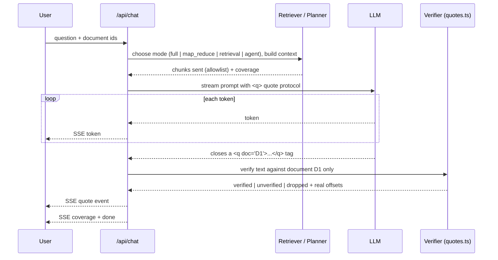

# Architecture

## Principles (fixed)
1. **One canonical text per document.** Extract once. Store the text and an array of page
   boundary offsets. Verification, highlighting, chunking, retrieval and comparison all use
   offsets into this one string.
2. **One quote-matching module** (`src/lib/quotes.ts`) used by the server verifier and the
   client highlighter. They can never disagree about where a quote is.
3. **Never trust the model.** We record what we sent. Quotes naming a document we did not
   send are dropped and counted. Model-reported pages and offsets are ignored.
4. **Guidance, never a crash.** Unverified quotes are visibly badged. A verifier failure
   degrades to "unverified" and never breaks a stream.
5. **Coverage honesty.** Every answer carries what was actually read. The model is not
   allowed to assert absence from partial coverage.
6. **Telemetry.** Count quotes proposed, verified, unverified, dropped per answer.

## Stack
Next.js (App Router, TypeScript, Tailwind), Node runtime. Postgres with Drizzle ORM.
OpenAI-compatible LLM client configured only by `LLM_BASE_URL`, `LLM_API_KEY`, `LLM_MODEL`.
Deploy target: Render (long streaming and processing jobs). See DECISIONS.md.

## Data model
```
documents(id, filename, mime, size_bytes, status, status_detail, reject_reason, page_count,
          char_count, text, sha256, unreadable_pages int[], created_at)
  status: uploading | extracting | indexing | ready | rejected | failed
document_files(id, document_id, data bytea, created_at)
pages(id, document_id, page_number, start_offset, end_offset, items jsonb)   -- DOCX uses virtual sections
chunks(id, document_id, ordinal, start_offset, end_offset, heading, clause_ref, token_est)
chats(id, scope[single|multi], title, created_at)
chat_documents(chat_id, document_id)
messages(id, chat_id, role, content, status[complete|stopped|error], mode, coverage jsonb,
         stats jsonb, created_at)
quotes(id, message_id, local_id, document_id, text, status[verified|unverified|dropped],
       reason, matches jsonb[{start,end}], chunk_id, created_at)
comparisons(id, doc_a_id, doc_b_id, status, overall_summary, created_at)
comparison_changes(id, comparison_id, kind[added|removed|modified|moved], ref_a, ref_b,
                   text_a, text_b, range_a, range_b, significance[high|medium|low|cosmetic],
                   category, summary, signals jsonb)
jobs(id, type, document_id, status, attempts, locked_at, last_error)   -- for resumable processing
```

## Ingestion pipeline
```
upload -> validate (extension + magic bytes + size/page limits)
       -> store raw file -> status: extracting
       -> extract (pdf.js per page | mammoth for DOCX)
       -> quality gate (see below) -> reject or continue
       -> build canonical text + page offsets
       -> chunk by clause/heading -> status: indexing (build BM25 index) -> ready
```
Status is pushed to the client (SSE or polling, see DECISIONS) so the user always sees a stage
and a progress figure (pages processed / total).

Quality gate (PDF): count non-whitespace characters per page. A page under 20 is "unreadable".
If total characters are under 100, or 80 percent or more of pages are unreadable, reject with
`no_text_layer` and a message explaining the file looks scanned. If only some pages are
unreadable, accept but store `unreadable_pages` and show a warning. These pages count against
coverage. Encrypted PDFs are rejected with `encrypted`.

## Chat and verification flow


### Quote protocol
The model writes prose and wraps each supporting quote inline as `<q id="1" doc="D1">exact text</q>`.
Inline tags (not a trailing JSON block) so that:
- each quote is verified the moment its tag closes, while streaming;
- stopping mid-answer keeps every already-verified quote, and an unclosed tag is dropped.
The client parser hides tag syntax and renders a numbered pill that updates when the `quote`
event arrives (pending, verified, unverified).

### SSE events
`token`, `quote` {localId, docId, status, reason, matches}, `coverage`, `progress` (agent),
`done`, `error`.

## Quote matching (src/lib/quotes.ts)
Implementation summary (details in the quote-verification skill):
- Normalise both sides char by char: Unicode NFKC, ligatures expanded, curly quotes to straight,
  all dash variants to `-`, soft hyphen and zero-width chars removed, lowercase, and **all
  whitespace removed**. Keep `map[i]` = original offset of normalised char i.
- Hyphenation at line end is handled by matching against two variants of the text
  (hyphen+newline removed, and hyphen kept).
- Find all occurrences, then reject mid-word matches by checking word boundaries in the
  original text. Return real `{start, end}` offsets in the canonical text.
- Quotes containing an ellipsis are split into segments that must all be found in order
  within a bounded window. They are marked "verified with gaps".
- Minimum normalised length is 15 characters. Shorter quotes are unverified (too generic to prove anything).
- Strict only. No fuzzy fallback, because that is how a paraphrase gets verified.

## Coverage model
```ts
type Coverage = {
  mode: 'full' | 'map_reduce' | 'retrieval' | 'agent'
  chunksTotal: number
  chunksRead: number
  complete: boolean              // every chunk of every selected doc was read
  unreadablePages: number[]      // from ingestion
  perDoc: Record<string, { chunksTotal: number; chunksRead: number }>
}
```
Rules:
- `complete=false`: the prompt forbids statements of absence, and requires wording like
  "I did not find X in the sections I searched (N of M)". The UI shows a coverage banner.
- Unreadable pages make `complete=false` even when every chunk was read.

## Large documents
Token estimate = chars / 4. `LLM_CONTEXT_BUDGET` (default 60k tokens) decides:
1. **full**: document fits, send everything. Coverage complete.
2. **map_reduce** (existence, absence, "list all", summary questions): split into chunks of about
   6k tokens with overlap, run the map step over ALL chunks (concurrency 4). Each map call returns
   candidate quotes plus relevance. Candidates are verified immediately against the chunk. The reduce
   step sees only verified candidates and writes the answer. Coverage is complete if no map call failed.
3. **retrieval** (targeted questions): BM25 over chunks, top-k plus neighbours. Coverage is always
   partial. Embeddings can replace BM25 later as an extra.

A cheap router (heuristics first, small LLM call if unsure) picks map_reduce vs retrieval.
Failed map calls are retried once, then reported as partial coverage.

## Multi-document
Documents are labelled `D1..Dn` with filenames in the prompt. The prompt requires a comparative
structure (by topic, with each document's position side by side). Every `<q>` carries a `doc`
attribute. The verifier checks the quote against that document only. A quote that exists in a
different selected document is **not** silently re-attributed. It is marked unverified with
reason `wrong_document`.

## Document comparison
```
parse both docs into clause units (numbered headings, else paragraphs)
-> align: match by clause number/heading, then text similarity (token Jaccard / TF-IDF cosine), greedy best match
-> classify each unit: unchanged | modified | added | removed | moved
-> for modified: deterministic signals (numbers, currency, dates, durations, modal verbs shall/may/must,
   negations, party names changed)
-> LLM judge on modified/added/removed units only (batched): significance + category + one-line plain summary,
   given the signals as hints
-> overall summary written from the high and medium items
```
Deterministic signals can raise significance, never lower it below what the LLM says. Pure rewording with
no signals is `cosmetic` or `low`. Clause renumbering alone is `moved`, not added plus removed.

## Part C: agent loop (Option 2)
Tools (validated with zod):
- `search_document({query: string, top_k?: 1..10, doc_id?: string})`: BM25 over chunks, returns snippets with chunk ids.
- `get_section({ref?: string, chunk_id?: string, doc_id?: string})`: returns full text of a clause or chunk.
- `list_clauses({doc_id?: string})`: returns the clause outline (ref, heading, chunk id).

Loop:
```
rounds = 0
while rounds < MAX_ROUNDS (default 6) and toolCalls < MAX_TOOL_CALLS (default 12):
  model step (streamed) -> either final answer or tool calls
  for each tool call: validate -> run -> append result (or a structured error message) -> emit progress event
  rounds++
if cap reached: force a final answer with the notice "research was limited, coverage partial"
final answer goes through the same <q> verification
```
Malformed calls (unknown tool, missing or wrongly typed args, nonsense values): never throw. Return a tool
result like `{"error":"unknown_tool","available":[...]}` to the model, count it as a round, emit a progress
note. Three consecutive invalid calls abort the loop with an honest partial answer.
Progress events are human-readable ("Searching for termination provisions...", "Reading clause 14.2...").
Coverage for agent mode = chunks the agent actually retrieved or read, so absence claims follow the same rule.
There is a hard per-request token budget in addition to the round cap.

## Module map
```
src/lib/quotes.ts              normalise, locate, verify (shared client+server)
src/lib/extraction/            pdf.ts, docx.ts, quality-gate.ts, canonicalise.ts
src/lib/chunking/              chunker.ts, clause-parser.ts, bm25.ts
src/lib/llm/                   client.ts (env config), prompts/, stream-parser.ts (<q> tag parser)
src/lib/agent/                 tools.ts, loop.ts, schemas.ts
src/lib/compare/               align.ts, signals.ts, judge.ts
src/server/                    db/, route helpers, jobs
src/app/                       UI routes and API routes
evals/                         fixtures, questions, run.ts
```

## Failure modes by component
| Component | Failure | Behaviour |
|---|---|---|
| Extraction | Library throws | status failed with readable reason, retry button |
| LLM | Timeout or 5xx | message status error, partial text kept, retry |
| Verifier | Throws | quote becomes unverified, error logged, stream continues |
| Stream | Client disconnects or Stop | server aborts upstream call, saves partial text |
| Map step | One chunk fails | retried once, then coverage partial and stated |
| Agent | Invalid tool call | structured error back to model, loop continues within cap |
| DB | Write fails | surfaced as error, never silent |

---

# Amendments (audit round 1)
These extend or supersede the sections above. Decision ids refer to DECISIONS.md.

## PDF viewer mapping (D-034, D-035)
- At extraction, per page, keep pdf.js text items in order and store `items = { starts: number[], lens: number[] }`: the offset
  and length of each item's string inside the canonical text (we know them because we build the canonical text from those items,
  including the separators we insert). Pin a single `pdfjs-dist` version for extraction and rendering.
- The client renders the real page (canvas plus pdf.js TextLayer). The text layer exposes its spans in item order. Check
  `spans.length === items.starts.length`. If not, fall back to the canonical-text viewer for that page and log it.
- Highlight: a match `[s, e)` goes through `splitByPages`. For each page range, every item overlapping the range gets a local
  character range inside its string, and that span is split into before / `<mark>` / after. Multi-line = several items, cross-page =
  ranges on two pages, repeated = the occurrence list.
- Scroll: `scrollIntoView({block: 'center'})` on the first highlighted span of the active occurrence.
- The raw file is served by `GET /api/documents/:id/file`.
- DOCX uses the canonical-text viewer with paragraph structure (no rendering of the original layout).

## Quote repair pass (D-036)
After streaming, if some quotes failed verification, make one repair call per answer: send only the failed quotes, the claims
they support and the cited chunk text, and ask for the exact wording or "none". Re-verify strictly. Verified repairs replace the
quote, otherwise the claim is shown as "no supporting quote". Telemetry counts `repaired`. Prompting also helps: quote first,
then write the claim, and give chunks with clear delimiters.

## Deep research toggle (D-037)
Composer toggle enables agent mode for the next question. A hint appears when the document is large and the question is open ended.
Works for multi-document chats.

## Tool-calling adapter (D-038)
`callModel(messages, tools)` returns a normalised `{ text } | { toolCalls[] }`. Implementation A: native `tool_calls`. Implementation B:
a JSON protocol in plain text (`{"action":"tool","name":"search_document","args":{...}}` or `{"action":"final"}`) parsed
tolerantly. Pick per provider at config time. The agent loop and its tests do not know which one is in use.

## Map-reduce progress
`progress` events are also emitted in map-reduce mode: "Reading section 12 of 48". The UI shows a determinate bar. Latency target
for a 150-page file: under 60 seconds with concurrency 4, otherwise lower the batch count or raise concurrency.

## Operational hardening (D-039, D-040)
- Stale-job sweep on server start: documents in `extracting` or `indexing` with no live worker (or older than 10 minutes) become
  `failed` with "Processing was interrupted". Retry re-runs from the stored raw file.
- Per-IP rate limits (default 10 uploads/hour, 40 chat requests/hour) and a global daily token ceiling from env. Friendly message when hit.
- AbortController propagates from the client Stop button to the server to the upstream model call.
- `GET /api/health` for the host's health check. Prefer a host plan that does not sleep, note cold starts in the README.
- Data note in the README: no auth, documents may be confidential, Delete removes file, text, chunks, quotes and chats.

## Comparison summary guard (D-041)
After the judge returns a summary, extract numbers, currency amounts and dates from it. Each must appear in the compared clause
texts or in the computed signals. If any does not, replace the summary with a template built from the signals
("Value changed from X to Y") and log `summary_guard_triggered`.

## Arabic hedge (D-044)
NFKC in the normaliser folds Arabic presentation forms. Text blocks use `dir="auto"`. The quality gate counts Arabic letters as
text. Ingestion must not crash or reject Arabic or bilingual files. Known limitation to document: some PDFs extract Arabic in visual
order, which can make quotes unverifiable. Test with one bilingual fixture.

## Sample contracts (D-042)
`POST /api/samples` seeds three synthetic documents, generated by a script and committed under `evals/fixtures/`: a services
agreement, a v2 with planted changes (cap 100,000 to 1,000,000, 30 to 90 days notice, shall to may, a renumbered clause, an added
and a removed clause, a rewording), and a long agreement of 120+ pages for large-document behaviour. Synthetic parties only.

## Chat history model
A single-document chat belongs to its document. The document page lists its past conversations (new chat, reopen). Multi-document
chats are listed in a separate "Multi-document" section of the sidebar. Opening a chat restores messages, quote statuses and coverage.
